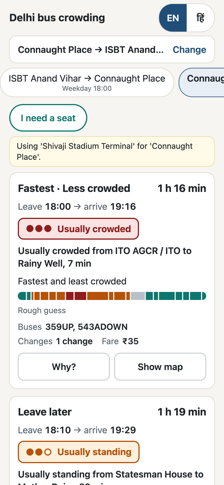
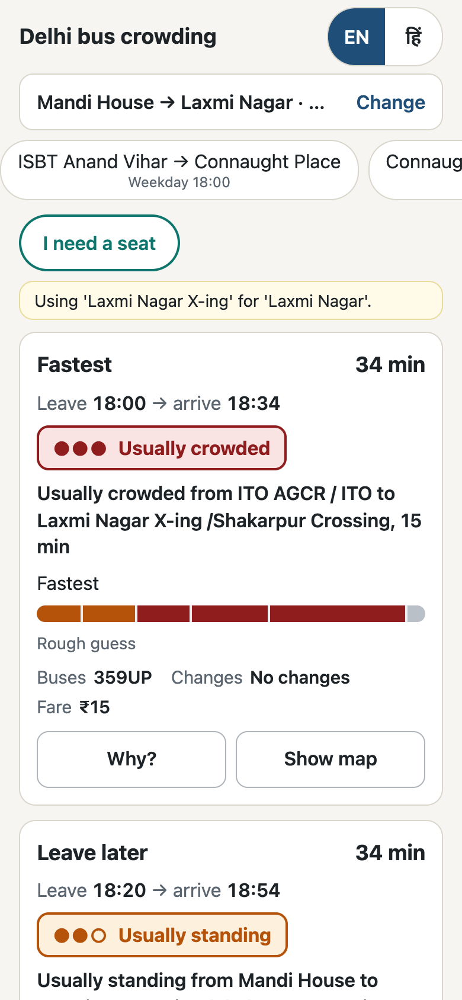
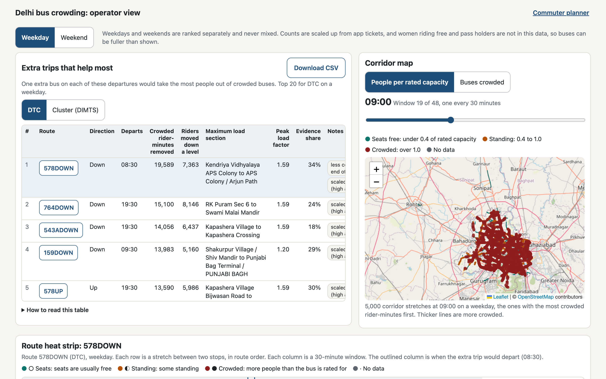
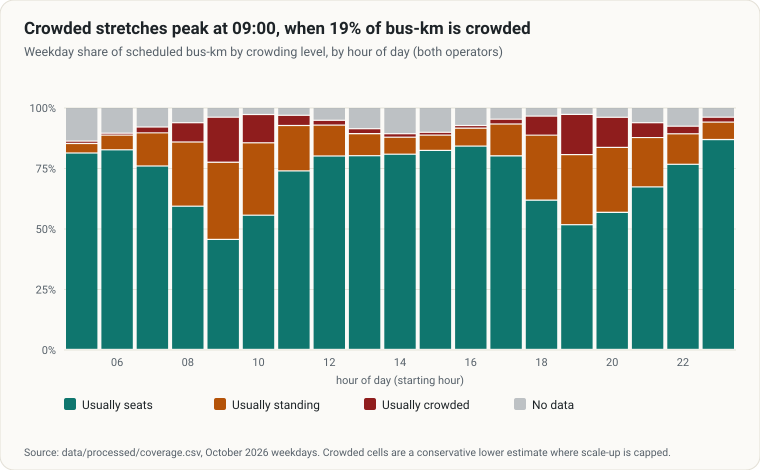
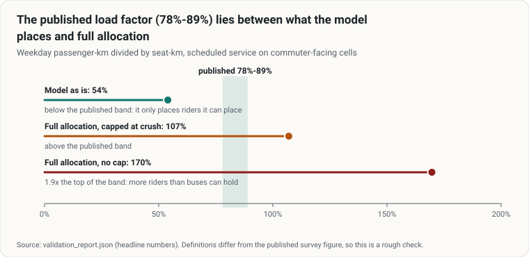
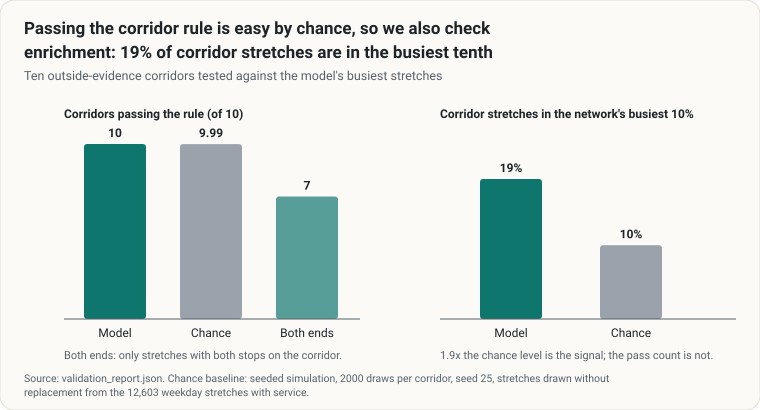
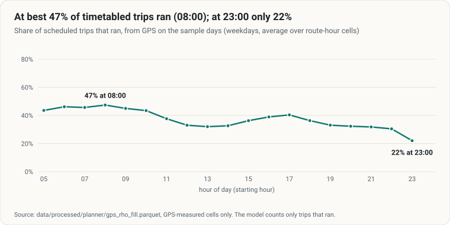
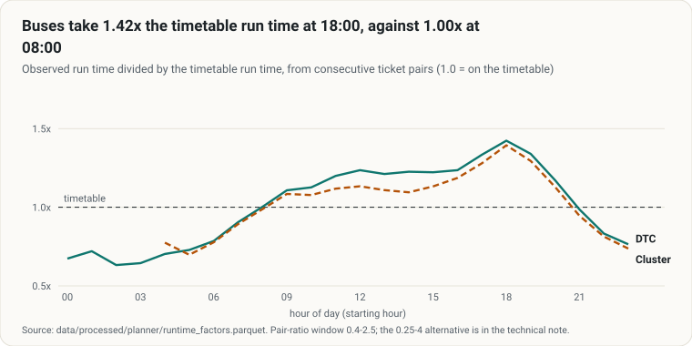

<!-- Rendered to README.md by `python -m src.pipeline.run --until render`. Edit this template, never README.md: every number below is a placeholder filled from the pipeline's own output. -->
<div align="center">

# Delhi Bus Crowding Planner

### See how crowded each stretch of your Delhi bus trip usually is — before you board.

[](https://delhi.transportstack.in/hackathon/)
[](requirements.lock)
[](https://huggingface.co/spaces/ThatAnacondaGuy/delhi-bus-crowd-planner)
[](tests)
[](LICENSE)

**[Live demo](https://huggingface.co/spaces/ThatAnacondaGuy/delhi-bus-crowd-planner)** ·
**[Technical note](docs/TECHNICAL_NOTE.md)** ·
**[Proposal (PDF)](docs/PROPOSAL.pdf)** ·
**[Validation report](data/processed/validation_report.md)**

<br>

<table>
  <tr>
    <td align="center" width="33%"></td>
    <td align="center" width="33%"></td>
    <td align="center" width="34%"></td>
  </tr>
  <tr>
    <td align="center"><sub><b>Commuter screen.</b> The busiest stretch is named, and the card says how sure we are.</sub></td>
    <td align="center"><sub><b>Leave later.</b> Shown only when a later bus is really better.</sub></td>
    <td align="center"><sub><b>Operator view.</b> Where one extra trip takes the most people out of crowded buses.</sub></td>
  </tr>
</table>

</div>

---

## Try it

**Live demo:** <https://huggingface.co/spaces/ThatAnacondaGuy/delhi-bus-crowd-planner>
It is a free static page with precomputed answers for a menu of well-known places and departure times, so it opens instantly and never sleeps. The full planner, where you type any pair of places, runs on your own computer from this repository ([Quick start](#quick-start)).

Five journeys to try first (weekday):

| # | Journey | Leaves | What it shows |
|---|---|---|---|
| 1 | ISBT Anand Vihar → Connaught Place | 18:00 | The brief's own example |
| 2 | Connaught Place → ISBT Anand Vihar | 18:00 | The reverse trip: the same road, a different answer by direction |
| 3 | Ambedkar Nagar → ITO | 09:00 | A morning trip on the Ambedkar Nagar – ITO corridor |
| 4 | Mandi House → Laxmi Nagar | 18:00 | A **Leave later** card: a later bus that is really better |
| 5 | Ambedkar Nagar → AIIMS | 09:00 | A **Less crowded** option that costs a few minutes |

## The problem

Delhi has thousands of buses, and every journey planner picks a trip by time alone. None of them can tell a rider that the fastest bus is the one that is usually packed at 18:00, or that leaving twenty minutes later usually means a seat. Nobody counts people on Delhi buses by stretch, so we estimate it from what *is* recorded: **{{tickets_clean:,}} ONDC app tickets from October 2026**, matched to the official timetable and to GPS traces, then scaled up to everyone on board and checked against everything we can compare it with.

The result is a crowding level for every route, direction, stretch between two stops and half hour, a planner that shows it beside each trip option, and a second screen that tells a bus operator where one extra trip helps most.

## How it works

<p align="center">
  <picture>
    <source media="(prefers-color-scheme: dark)" srcset="docs/assets/architecture-dark.svg">
    
  </picture>
</p>

<sub>Data packets move along the arrows and each stage lights up in pipeline order. Switch on "reduce motion" in your system settings and the picture stands still.</sub>

**One ticket's story.** Every ticket says where a rider boarded and where they got off. We spread it over the stretches that rider travelled, at the time the bus was on each stretch. We add up everyone on that stretch in a half-hour window, scale the app tickets up to all riders, divide by the buses that really ran, and compare the people on board with the seats and the bus's rated total.

<p align="center">
  <picture>
    <source media="(prefers-color-scheme: dark)" srcset="docs/assets/how-it-works-dark.svg">
    
  </picture>
</p>

### What a rider sees

Every level is a word, dots and a colour, never colour alone, and each one comes in Hindi.

| Level | Meaning | Hindi |
|---|---|---|
| ●○○ **Usually seats** | people on board stay under {{seats_fraction:.0%}} of the seats, because some seats are reserved | आमतौर पर सीट मिल जाती है |
| ●●○ **Usually standing** | more than that, up to what the bus is rated to carry | आमतौर पर खड़े होकर जाना पड़ता है |
| ●●● **Usually crowded** | more people than the bus is rated to carry | आमतौर पर भारी भीड़ |
| ○○○ **No data** | not enough tickets or no bus scheduled; never shown as comfortable | जानकारी नहीं |

Each card also says **Based on many tickets** (कई टिकटों पर आधारित) or **Rough guess** (अंदाज़ा (कम टिकट)), names the crowded stretch, and offers three roles: **Fastest**, **Less crowded** and **Leave later**. A **Why?** sheet shows the people-on-board range against the bus's seats and rated total, and says plainly that the data is app tickets, scaled up.

## What makes it trustworthy

We wrote down what we expected to see **before** the first full run (`validation/expectations.yaml`), then reported every hit and every miss. **No field count was possible**: the team is in Pune and no one has counted people on Delhi buses, so none of this measures how close a level is to the truth on a given bus. What we can do is test the model against everything that can be compared with it.

<p align="center">
  
</p>

| Check | Result |
|---|---|
| **Run stops if broken.** Ticket conservation, rider-minutes within {{conservation_tol:.1%}}, buses for the riders, run times, schema, no NaN | All pass. Rider-minutes differ by {{rider_minutes_gate_deviation:.3%}}; run times by at most {{run_time_gate_max_deviation:.1%}} |
| **Peaks** written down in advance: morning 08–10, evening 17–20 | **Hit.** Busiest hours are {{am_peak_hour:02d}}:00 and {{pm_peak_hour:02d}}:00 |
| **Weekends** lower, flatter, later peak | **Hit** on all three |
| **Direction.** Inbound busier in the morning, outbound in the evening | **Hit.** {{radial_am_share:.0%}} of {{radial_pairs}} radial route pairs in the morning, {{radial_pm_share:.0%}} in the evening |
| **Week to week.** Two different weeks of the month, each alone | {{unchanged_level_share:.0%}} of rider-weighted cells keep their level; load correlation {{load_correlation_week_pairs:.2f}}. A held-out week lands inside our range in {{range_coverage_heldout:.0%}} of cells |
| **Published DTC bus-km per day** against {{dtc_bus_km_published:,.0f}} | **Hit.** Model {{dtc_bus_km_model:,.0f}} |
| **Published load factor** band {{load_factor_band_low:.2f}}–{{load_factor_band_high:.2f}} | **Miss.** Model {{load_factor_model:.2f}}, below the band. See the bracket below |
| **Ten researched busy corridors** | {{corridor_hits_total}} of {{corridors_total}} by the rule we wrote down, **but chance alone gives {{corridor_hits_chance_expected:.1f}} of {{corridors_total}}**, so that proves little. The honest readings: {{corridor_top_decile_share_mean:.0%}} of corridor stretches sit in the top decile (chance {{corridor_top_decile_chance:.0%}}), and {{corridor_hits_both_ends}} of {{corridors_total}} hit with both ends on the corridor |

<details>
<summary><b>The load-factor miss, explained (it matters)</b></summary>

<br>

Published ridership, the trips GPS shows actually ran, and a bus's crush capacity do not fit together. With the model as it stands (no bus ever carries more than its crush load; riders no bus can carry are left unplaced) the weekday load factor is **{{load_factor_model:.2f}}**. With the capacity bound off and all published ridership placed it is **{{load_factor_full_allocation:.2f}}**. The published band of {{load_factor_band_low:.2f}}–{{load_factor_band_high:.2f}} lies between the two. We did not tune anything to close the gap; on routes where the capacity bound binds, **the crowding shown is a conservative, lower estimate.**

<p align="center">
  
</p>

</details>

<details>
<summary><b>More figures: the corridor check, trips that ran, travel-time factor</b></summary>

<br>

<p align="center">
  <br><br>
  <br><br>
  
</p>

</details>

The full account, with method, assumptions, sensitivity tests and the checks that did not come out our way, is in the **[technical note](docs/TECHNICAL_NOTE.md)** and the generated **[validation report](data/processed/validation_report.md)**.

## Limits, stated plainly

- **Most levels are a Rough guess.** Only {{bus_km_share_many_tickets:.1%}} of scheduled bus-km rests on many tickets; {{evidence_rough_share:.0%}} is a rough guess and {{evidence_none_share:.1%}} is No data. The card says which one it is.
- **App tickets are about 1 in {{app_riders_one_in}} riders.** We scale them up, never to more than a bus can hold. Women riding free, pass holders and cash riders are not in this data, so buses can be fuller than shown.
- **Capped routes read low.** On {{capped_routes:,}} routes the scale is held to bus capacity; {{unallocated_share_dtc:.0%}} of published DTC ridership and {{unallocated_share_dimts:.0%}} of cluster ridership could not be placed.
- **One month.** October 2026, which includes a festival season; weekends are thin.
- **Timetables are templates.** The official run times are a straight-line template, so we take run times from ticket pairs. GPS runs about {{gps_runtime_ratio_min:.2f}} to {{gps_runtime_ratio_max:.2f}} times that clock on weekdays; we state it and do not apply it.
- **GPS is a check, not ground truth.** About {{gps_trips_ran_share_weekday:.0%}} of scheduled trips show up as having run; we use that to count buses.
- **No live arrivals, no live load per bus.** Levels are what is *usually* so at that stretch and hour.

## Quick start

Python 3.12 and [`uv`](https://docs.astral.sh/uv/). The raw ticket and GTFS files are not in the repository (size and terms of use); the small GPS aggregate that the pipeline needs is.

1. **Clone the repository.**
   ```bash
   git clone https://github.com/ThatAnacondaGuy/Delhi-Bus-Crowd-Planner && cd Delhi-Bus-Crowd-Planner
   ```
2. **Install the pinned packages.**
   ```bash
   uv venv --python 3.12 && source .venv/bin/activate
   uv pip install -r requirements.lock
   ```
3. **Place the data** from Transport Stack: `October-Delhi.csv` in `data/raw/` and the GTFS folder `delhi_buses_static_gtfs_v1/` in `data/raw/gtfs/`.
4. **Run the pipeline** (resumable: finished stages are skipped).
   ```bash
   python -m src.pipeline.run
   ```
5. **Start the planner**, then open <http://127.0.0.1:8000> for riders and <http://127.0.0.1:8000/operator> for operators.
   ```bash
   uvicorn src.api.main:app
   ```

Tests: `python -m pytest`. Health check: `/v1/health` reports the data version and what is loaded. Interactive API docs: `/docs`.

## Repository map

```text
src/pipeline/    the eight stages: clean, resolve, network, gps, loads, operator, validate, render
src/routing/     the planner: frequency-based round search, option roles, headline rules
src/api/         FastAPI service, /v1/plan, /v1/crowding, /v1/corridors, /v1/operator/trips
frontend/        commuter screen (English and Hindi) and operator view; no build step
validation/      expectations.yaml, written down before the first full run
docs/            technical note, proposal, figure and diagram scripts, docs/assets pictures
deploy/          bundle builder for the demo (aggregates only)
data/processed/  the small reports that are committed: validation report, coverage, data quality
data/gps_aggregates/  the committed GPS aggregate (trips that ran, by route and hour)
tests/           unit, golden-journey and documentation tests
```

<sub>README, technical note and proposal are rendered from `*.tmpl.md` templates by the last pipeline stage, so every number in them comes from the run that produced the tables (run `{{run_id}}`, code `{{code_version}}`, finished {{pipeline_finished_ist}} IST).</sub>

## Data and credit

**Data: Transport Stack / IIIT Delhi; ticketing from ONDC e-ticketing.**

| Source | What we use | In this repository |
|---|---|---|
| ONDC e-ticketing, October 2026 | {{tickets_clean:,}} tickets, {{passengers_clean:,}} passengers, {{days_in_file}} days, {{route_strings:,}} route strings | No. Only aggregates |
| Static GTFS, DTC and cluster | {{gtfs_routes:,}} routes, stops, timetables, shapes | No |
| DTC bus GPS, October 2026 | Share of scheduled trips that ran, and run-time cross-check, from {{gps_sample_days}} sample days | Aggregate only |
| Economic Survey of Delhi 2025-26 and CAG audit | Published ridership, bus-km and load factor, used as outside checks | Cited in the technical note |

No ticket-level or vehicle-level data is committed or served; every response is an aggregate by route, stretch, corridor or scheduled trip.

## Phase 2

The aim is the same product with the evidence getting stronger: more months of tickets, so more cells rest on many tickets; a way to find out how many people really ride (a small on-bus count on a few corridors, if the transport department agrees); GPS stop times at scale to link a ticket to its exact trip; live arrival times; full Hindi stop search; and a hosted version that can serve many riders. The technical note lists them with the reason for each.

## Team

**Aniket Ingale** and **Ashish Maurya (Ash)**, Pune. Transport Stack Hackathon 2026, Problem 2: a crowdedness-aware journey planner for Delhi buses.

<sub>MIT licence. Built with Python, DuckDB, pandas, FastAPI and plain JavaScript.</sub>
