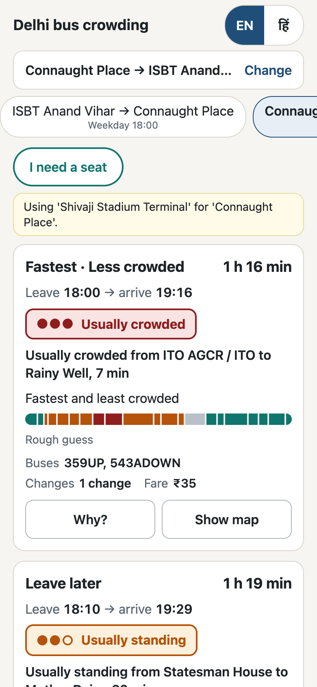
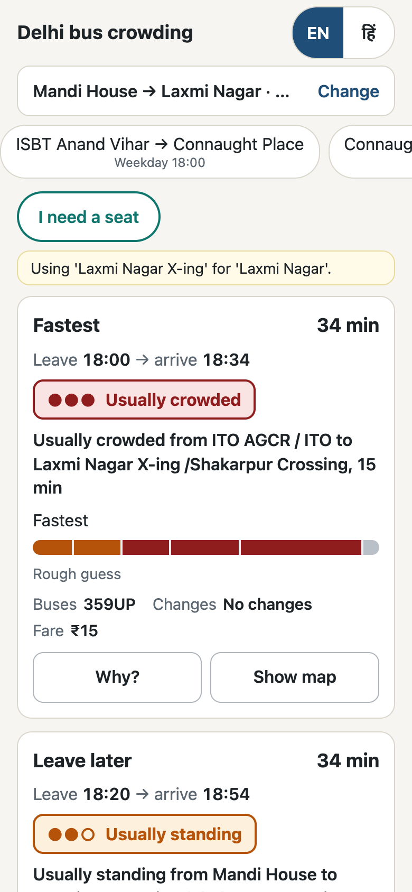
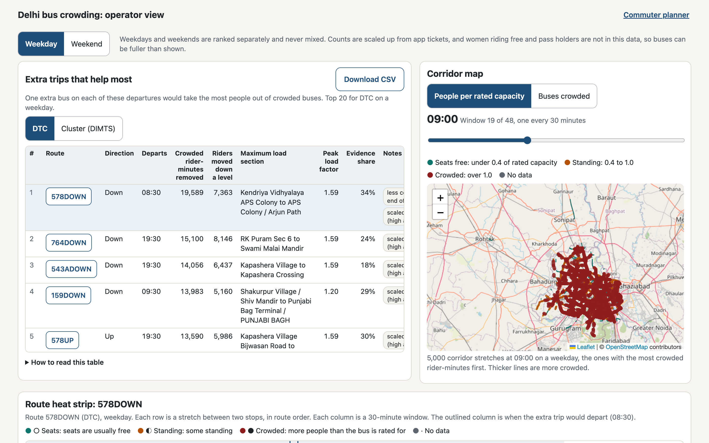

<!-- Rendered to PROPOSAL.md by `python -m src.pipeline.run --until render`; PROPOSAL.pdf is made from it by `python docs/make_proposal_pdf.py`. Edit this template, never the .md: every number is a placeholder filled from the pipeline's own output. -->

# Delhi Bus Crowding Planner

See how crowded each stretch of your Delhi bus trip usually is, before you board.

Transport Stack Hackathon 2026 · Phase 1 · Problem 2: a crowdedness-aware journey planner · Team Kshama: Aniket Ingale and Ashish Maurya (Ash), Pune

## The problem

Delhi riders choose buses by travel time alone, because no journey planner knows how full a bus will be. The fastest bus may be the one that is usually packed at 18:00, and leaving a few minutes later may mean a less crowded bus. Nobody counts people on Delhi buses stretch by stretch, so we estimate it from the one dataset that is recorded: **{{tickets_clean:,}} ONDC app tickets from October 2026**, matched to the official timetable and to GPS, scaled up to everyone on board, and tested against everything we can compare it with. The brief says a simple planner with a sound crowding model beats a polished planner with a weak one. We built the model and its evidence first, then a clear screen.

## What we built

|  |  |  |
|:-:|:-:|:-:|
| **For a rider.** Three options per trip: Fastest, Less crowded, Leave later. Each has a level (Usually seats, Usually standing, Usually crowded or No data), the crowded stretch by name, and how sure we are. English and Hindi. | **Leave later.** Offered only when a later bus is really in a better level and still runs. A *Why?* sheet shows the people-on-board range against the bus's seats and rated total. | **For an operator.** The extra trips that take the most people out of crowded buses, a corridor map with a time slider and a route heat strip, with CSV export. |

- **Crowding tables** for every route, direction, stretch and half hour, weekday and weekend, with an evidence state on every cell: *Based on many tickets*, *Rough guess* or *No data*. {{stretch_crowding_rows:,}} rows, rebuilt by one command.
- **Honest by design.** No value is invented; a stretch without evidence is *No data*, never shown as comfortable; every number in our documents is read from the pipeline's own output.

## How it works

<picture>
  <source media="(prefers-color-scheme: dark)" srcset="assets/architecture-dark.svg">
  
</picture>

Each ticket says where a rider boarded and got off. We spread it over the stretches travelled, at the time the bus was there, add up everyone per stretch and half hour, scale the app tickets up to all riders, divide by the buses that really ran (from GPS) and compare people on board with the bus's seats and rated total. Seats, rated total and crush load are set by bus type: 12 m AC {{seats_12m_ac}}/{{rated_12m_ac}}/{{crush_12m_ac}}, 9 m DEVI {{seats_9m_devi}}/{{rated_9m_devi}}/{{crush_9m_devi}}.

## Evidence, with the misses

**No field count was possible**: we are in Pune and no one has counted people on Delhi buses. So we wrote our expectations down before the first full run and report every hit and every miss.

| **{{match_rate:.1%}}** | **1 in {{app_riders_one_in}}** | **{{unchanged_level_share:.0%}}** | **{{dtc_bus_km_model:,.0f}}** |
|:-:|:-:|:-:|:-:|
| of {{tickets_clean:,}} tickets resolved to a route and stops | riders are in the app data; we scale up, never above what a bus holds | of cells keep their level between two different weeks | DTC bus-km a day modelled; {{dtc_bus_km_published:,.0f}} published |

| Check written down in advance | Result |
|---|---|
| Morning and evening peaks | **Hit**: busiest hours {{am_peak_hour:02d}}:00 and {{pm_peak_hour:02d}}:00 |
| Weekends lower, flatter, later peak | **Hit** on all three |
| Inbound busier in the morning, outbound in the evening | **Hit**: {{radial_am_share:.0%}} and {{radial_pm_share:.0%}} of {{radial_pairs}} route pairs |
| Published DTC bus-km | **Hit**: within the band once GPS measured the trips that ran (the timetable alone was {{dtc_bus_km_scheduled_ratio:.2f}} times the published figure); GPS and the published figure are independent |
| Published fleet load factor ({{load_factor_band_low:.2f}}–{{load_factor_band_high:.2f}}) | **Miss**: {{load_factor_model:.2f}}. Published ridership, GPS trips and bus capacity do not fit together, so on capped routes crowding shown is a lower estimate |
| Ten researched busy corridors | {{corridor_hits_total}} of {{corridors_total}} by our rule, but chance alone gives {{corridor_hits_chance_expected:.1f}}, so we also report: {{corridor_top_decile_share_mean:.0%}} of corridor stretches are in the top decile (chance {{corridor_top_decile_chance:.0%}}); {{corridor_hits_both_ends}} of {{corridors_total}} hit with both ends on the corridor |
| Week to week, two different weeks | {{unchanged_level_share:.0%}} unchanged; a held-out week lands in our range in {{range_coverage_heldout:.0%}} of cells |

## Limits, stated plainly

- **Most levels are a Rough guess:** only {{bus_km_share_many_tickets:.1%}} of bus-km rests on many tickets, {{evidence_rough_share:.0%}} is a rough guess and {{evidence_none_share:.1%}} is No data. The card says which.
- **App tickets only.** Women riding free, pass holders and cash riders are not in the data, so buses can be fuller than shown.
- **Capped routes read low:** on {{capped_routes:,}} routes the scale is held to bus capacity; {{unallocated_share_dtc:.0%}} of DTC and {{unallocated_share_dimts:.0%}} of cluster published ridership could not be placed.
- **One month**, a festival-season October. Timetable times are a template, so run times come from ticket pairs; GPS runs about {{gps_runtime_ratio_min:.2f}}–{{gps_runtime_ratio_max:.2f}} times that clock on weekdays and we say so instead of applying it.

## Phase 2

An on-bus count on a few corridors to replace our one unverifiable step, the scale-up from app riders to everyone; more months of tickets so more cells rest on many tickets; GPS stop times to link a ticket to its exact trip; free-ride and pass counts by route if the operator can share them; live arrivals and load; full Hindi stop search; and a hosted service for many riders. The technical note gives the reason for each.

## Links and credit

| | |
|---|---|
| **Live demo** | <https://huggingface.co/spaces/ThatAnacondaGuy/delhi-bus-crowd-planner> (precomputed answers for well-known places and times; the full planner runs locally) |
| **Code, README, technical note** | <https://github.com/ThatAnacondaGuy/Delhi-Bus-Crowd-Planner> |
| **Team** | Team Kshama: Aniket Ingale and Ashish Maurya (Ash) |

Data: Transport Stack / IIIT Delhi; ticketing from ONDC e-ticketing. Aggregates only: no ticket-level or vehicle-level data is published. Figures rendered from run {{run_id}}, code {{code_version}}, {{pipeline_finished_date}}.

