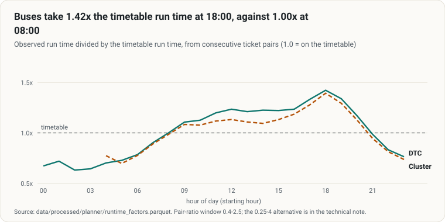
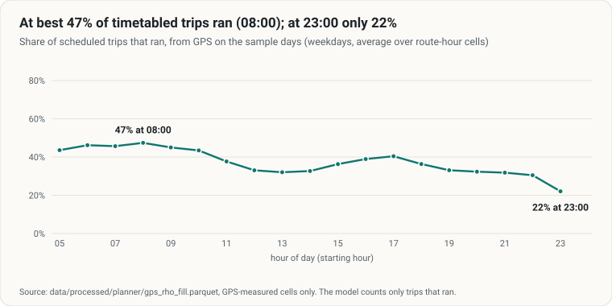
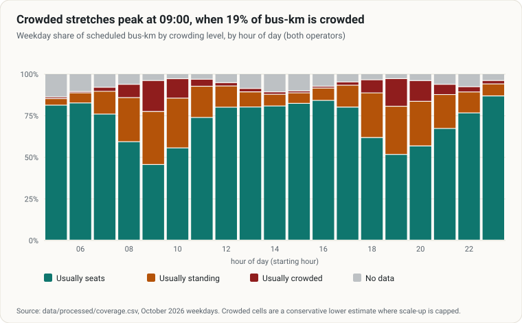
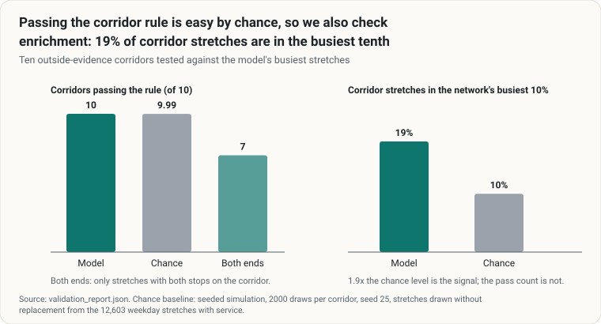
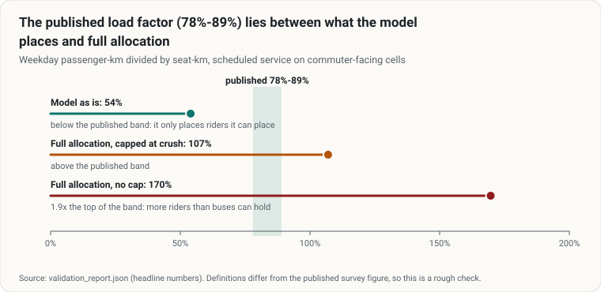

<!-- Rendered to TECHNICAL_NOTE.md by `python -m src.pipeline.run --until render`. Edit this template, never the .md: every number is a placeholder filled from the pipeline's own output or from config.py. -->
<div align="center">

# Technical note

### How we estimate how crowded a Delhi bus stretch usually is, and how far to trust it

Transport Stack Hackathon 2026 · Phase 1 · Problem 2 · Aniket Ingale and Ashish Maurya (Ash)

<sub>Run `20261123-1952-f9fb356b` · code `7ad173f` · finished 2026-11-23 19:52 IST · every number below is read from that run</sub>

</div>

> **In one paragraph.** From 2,559,899 ONDC app tickets (October 2026) we estimate, for every Delhi bus route, direction, stretch between two stops and half hour, how many people are usually on board, and we show it to riders as a level: *Usually seats*, *Usually standing*, *Usually crowded* or *No data*. App tickets are about 1 in 44 riders, so we scale them up, never to more than a bus can hold. **No field count was possible**, so we test the model against everything we can compare it with and report the misses beside the hits. Most levels (89% of bus-km) are a Rough guess, and the card says so.

**Contents:** [1 Data](#1-data-and-what-it-cannot-see) · [2 Method](#2-method) · [3 Assumptions](#3-assumptions) · [4 Brief checklist](#4-the-brief-checklist) · [5 App share and the hackathon figure](#5-reconciling-the-app-share) · [6 Validation](#6-validation-and-independent-checks) · [7 Coverage and weak spots](#7-coverage-and-the-least-reliable-areas) · [8 Phase 2](#8-phase-2) · [Appendix](#appendix)

---

## 1. Data and what it cannot see

**Tickets.** One CSV of ONDC app and QR tickets, 1–31 October 2026: 2,559,899 tickets, 2,753,606 passengers, 2,259 route strings. Each row has the route string, boarding and alighting stop names, passengers, fare, time (time-zone aware; we pin every operation to Asia/Kolkata) and, on 48.5% of rows, no vehicle number. Both ticket channels are bought on board and behave as one population, so we never use the missing-vehicle share to scale anything.

Known holes are cut out of every rider count: 2 October (public holiday) and 20 October (Dussehra) as whole days, and three windows (6 October morning, 17–19 October when one channel fell to a quarter of normal, 29 October evening). That leaves 29 clean days of 31.

**Timetable (GTFS).** 2,574 routes for DTC and the cluster operator, one service day for every day of the week. The scheduled times are a template: every stop-to-stop time equals the straight-line distance at a fixed 18 km/h, so they carry no information about real traffic. Direction is not in the feed; it is read from the route name (UP, DOWN, ring markers, A-B pairs).

**GPS.** The October 2026 DTC feed (about 11–12 s between pings for most buses). We do not publish it. We reduce it to one aggregate (the share of scheduled trips that ran, by route, hour and day type, and a run-time ratio) from 10 sample days, and only that aggregate is in the repository.

**Outside figures** used only as checks: published daily ridership, bus-km and load factor (Economic Survey of Delhi 2025-26; CAG report 4 of 2024), and ten corridors researched without looking at our output.

**What the data cannot see.** Women riding free, pass holders and cash riders are not in app tickets. The month is one festival-season October. There is no count of people on a bus anywhere in it. Everything in this note follows from those three facts.

<p align="center">
  <picture>
    <source media="(prefers-color-scheme: dark)" srcset="assets/architecture-dark.svg">
    
  </picture>
</p>

---

## 2. Method

Eight resumable stages (`python -m src.pipeline.run`), each reading and writing tables in one DuckDB file. Each step below says what it does, why, and where it can be wrong.

### 2.1 Resolve tickets to the timetable

Stop names in tickets are free text ("Ito Agcr / Ito", "sec", "stn"). Names are first tidied (common abbreviations such as "stn" are expanded). For each route we then match each name only against that route's own stops: an exact match first, then a fuzzy match with a floor of 78 out of 100. Ties between equally good stops are broken by a second and third comparison; if still tied the ticket is rejected as ambiguous rather than guessed. Route strings that match no route exactly are tried against close aliases (for example the same number without a variant suffix such as STL or EXT) and accepted only when at least 80% of their tickets resolve in stop order on that route.

**Result:** 2,420,185 of 2,559,899 tickets resolved (94.5% of tickets, 94.5% of passengers). The 139,714 rejected are counted by reason in [Appendix A](#a-tickets-that-did-not-resolve). Ticket conservation is a gate: raw = resolved + rejected, per route string.

### 2.2 The travel-time clock

Because the timetable is a template, run times come from tickets. Two tickets bought on the same vehicle, route and day give the real time between two boarding stops. We compare that with the template time and average the ratio by operator and hour (and by route where it has at least 30 pairs).

| Hour of day | DTC: observed ÷ template | Cluster: observed ÷ template |
|---|---|---|
| 06:00 | 0.79 | 0.78 |
| 08:00 | 1.00 | 0.99 |
| 12:00 | 1.24 | 1.13 |
| 18:00 | 1.42 | 1.39 |
| 22:00 | 0.83 | 0.81 |

<sub>From 206,984 ticket pairs. Early morning is faster than the template, the evening peak is about 1.4 times slower.</sub>

**A choice we made after seeing numbers, so we show both.** A pair of consecutive tickets can span two different trips (a rider boards a later bus) or be a batch print. We keep pairs whose ratio is between 0.4-2.5 and drop the rest. The window was chosen after looking at the data, so here is the wider 0.25-4 window: the DTC 18:00 factor would be 1.521 instead of 1.423, and 08:00 would be 1.033 instead of 1.003. The 08:00 value stays near 1.0 under both windows.

**GPS disagrees a little, and we say so.** On weekdays between 05:00 and 21:00 GPS run times are 1.08 to 1.24 times the ticket clock (median 1.16), so real trips are roughly 10–20% slower than our clock. We state this and do not apply it. The ticket clock is measured between boarding stops of paying riders; we have not worked out which clock is closer to the truth, so planner travel times may be a little short.

<p align="center"></p>

### 2.3 Which scheduled trips really ran

The timetable lists 80,357 trips a day. DTC's published bus-km is far below what that schedule implies, so dividing riders by *scheduled* buses would spread them too thinly. From GPS we count a trip as run when one vehicle passes at least 80% of the route's stops in order (positions interpolated between pings, within 75 m of a stop). The share that ran is set only where at least 80% of the route's ticket-linked vehicles appear in the feed (1,733 of 2,574 routes). Everywhere else it falls back, in order, to the route's own value, then to the operator's value for that hour and day type, then to the operator's value for the day type. It is never set to 1.

**Result:** about 38% of scheduled trips show up as having run on weekdays. Applied to the timetable, DTC bus-km come to 496,158 a day against 501,000 published, which is an independent check on the trip-ran rule, not something the rule was fitted to (6.4 also says how far the timetable alone was off).

<p align="center"></p>

### 2.4 Riders on each stretch

Each resolved ticket is placed on the stretches between its boarding and alighting stops, at the time the bus is on each stretch: purchase time plus the corrected run time from the boarding stop. Purchase time is a good proxy for boarding. Every stretch exists in every window with explicit zeros, so a quiet stretch is a measured zero, not a missing value.

**Alighting correction.** App tickets end at route terminals more often than they start there (people buy near the end of a ride): the median route-direction has 1.36 times as many terminal alightings as the reverse direction has terminal boardings, and one route direction in ten sits at the 2.0 cap (ratios are clamped there, so how far above it the true ratio goes is not visible). We cap terminal alightings at the reverse route's terminal boardings times the route's intermediate-stop ratio, and spread the excess over earlier stops in the same fare slab in proportion to the reverse direction's boardings. If the reverse route has fewer than 5 terminal boardings in the month it is uninformative, so we apply no correction and flag the route instead. Of 1,674 route directions, 1,012 have a known ratio, 816 were corrected (145,061 passengers moved) and 662 are flagged *alighting-sensitive*: their last 2 stretches show a Rough guess at best. The result is published with and without the correction (6.5).

### 2.5 Buses and riders per bus

Riders and buses are counted in a centred 90-minute window, reported every 30 minutes on weekdays (120 and 60 on weekends, where tickets are thinner). Buses on a stretch are the scheduled buses passing in that window times the share that ran. If no bus is scheduled while riders exist, we widen the window by 30 minutes each side, then to the route-hour; if there is still none the cell says "no bus scheduled" and riders see No data. We never divide by a floor value. After the fallback, 0.72% of rider volume has no bus (the gate allows 1%). App riders per bus ℓ is riders divided by buses, per clean day.

### 2.6 Scaling app riders up to people on board

This is the step that matters most and the one we are least able to verify, so we describe it in full.

1. **Operator scale E.** Published daily ridership divided by app passengers resolved per clean day: **34.8** for DTC and **77.2** for the cluster operator. One citywide factor would be wrong: app use differs by operator and by route, so a single factor would put some routes far above what a bus can hold.
2. **Capacity bound per route.** B = a route's crush load divided by the 95th percentile of its weekday-peak app riders per bus, over cells with at least 30 tickets. A route's scale is E or B, whichever is smaller; the operator's E is raised (by bisection, "water-filling") so that the totals still match published ridership. Routes where the bound binds are flagged *scaled to bus capacity (high app use)*: **1,257** routes (847 DTC, 410 cluster).
3. **A ceiling of 3 times E.** Without it, thin cluster routes absorbed riders the model could not justify. With the ceiling, the operator scale reaches 104.4 for DTC and 231.5 for the cluster, the ceiling binds for both, and **59% of published DTC ridership and 73% of published cluster ridership is left unplaced.** We report that instead of forcing the totals to match. The ceiling was a modelling choice; 2× and 5× change 1.4% and 1.7% of levels.
4. **People on board** L = route scale × ℓ, shown as a range that combines the sampling error (day-to-day variation) and the scale uncertainty (0.7–1.3 times the route scale, upper end capped at B). Displayed people on board are capped at the crush load, with a flag *full: real demand is likely higher*.

What the caps mean: on capped routes the crowding we show is a **conservative, lower estimate**. We may under-call a crowded bus; the design avoids the opposite error.

### 2.7 Levels and evidence

Levels use each route's bus mix (seats, rated total, crush; Appendix B). *Usually seats*: L below 70% of seats, because reserved seats are rarely free. *Usually standing*: L up to the rated total. *Usually crowded*: L above the rated total. Mixed fleets use share-weighted thresholds.

Every cell also carries an evidence state:
- **Based on many tickets:** the level is the same across the whole range.
- **Rough guess:** the range spans two levels, or the route is flagged *low app use* (app riders per scheduled trip below 33% of the shared-stretch median). A quiet count on a route that does sell app tickets is evidence of a quiet bus, so *Usually seats* is allowed as a rough guess.
- **No data:** the route's app riders per scheduled trip are below the network 25th percentile, or no bus is scheduled. It is never shown as comfortable.

There is no shrinkage and no bunching factor: sparse cells are handled by the wider windows and these rules.

### 2.8 The planner

A frequency-based round search suits buses that run to headways, not timetables; waits are half the headway from buses that really ran. The planner returns three roles:

- **Fastest.**
- **Less crowded:** within the larger of 15 minutes or 30% of the fastest, with the fewest minutes crowded and then standing, using the upper end of the range. Not offered if more than half of it is No data, or if its advantage rests on legs flagged *low app use*.
- **Leave later** (+10 to +40 minutes): offered only if the later trip's whole range is in a better level and the route still runs.

The **headline** level is the worst level the rider spends at least 5 minutes in, with the crowded stretch named. If more than 50% of the ride is No data, the headline is *No data* (it is never *Usually seats* over a mostly unknown ride). Routes with fewer than 3 scheduled trips a day are timetable-only and are not used by the planner (they remain in all tables and in the operator view). Before 5:00 and after 23:00 options are marked "timetable uncertain".

### 2.9 The operator view

For each route-direction and departure window, we walk one extra bus down its route at the times it reaches each stretch (buses become S + 1), and count the riders whose level improves and the *crowded rider-minutes* removed. Weekdays and weekends are ranked separately. On weekdays the best single extra trip for DTC is route **578DOWN at 08:30**, removing about 19,589 crowded rider-minutes and moving about 7,363 riders down a level; for the cluster it is **539UP at 18:30** (16,940 and 8,867). These are model estimates scaled from app tickets, not counts.

<p align="center">
  <picture>
    <source media="(prefers-color-scheme: dark)" srcset="assets/how-it-works-dark.svg">
    
  </picture>
</p>

---

## 3. Assumptions

Every constant below lives in code, mostly in [`src/pipeline/config.py`](../src/pipeline/config.py), with its source. The last column is from the sensitivity runs in 6.5 (share of commuter-facing cells whose level changes).

| Assumption | Value | Where | Why | If it is wrong |
|---|---|---|---|---|
| 12 m AC bus: seats / rated total / crush | 35 / 63 / 100 | `BUS_SPECS` | DTC e-bus tender and CESL tender (seats); Tata and Switch data sheets (rated total); DTC tenders "peak loading of over 100" (crush) | Capacity ±10%: 0.4% / 0.3% of cells |
| 9 m DEVI bus | 23 / 36 / 42 | `BUS_SPECS` | Press reports of the DEVI order (23 seated, 13 standing); highest stated 9 m capacity | As above |
| 12 m non-AC CNG bus | 37 / 63 / 100 | `BUS_SPECS` | The seat figure has the weakest source | As above |
| "Comfortable capacity" alternative | 12 m 77, 9 m 32 | `BUS_SPECS` | Seats plus four standees per m², the CESL off-peak cap | 1.7% of cells |
| *Usually seats* below this share of seats | 70% | `SEATS_FRACTION` | Reserved seats are rarely free | Not varied |
| Scale range around a route's scale | 0.7–1.3 × | `SCALE_RANGE` | Honest width for the scale uncertainty | E −30% / +30%: 9.2% / 8.2% |
| Capacity bound | 95th percentile, cells with 30+ tickets | `BOUND_PERCENTILE`, `BOUND_MIN_TICKETS` | Stops a thin route absorbing impossible loads | Bound off: **38.5%** |
| Operator scale ceiling | 3 × E | `E_SCALE_CEILING_MULT` | Stops unbounded scale on thin routes; leaves ridership unplaced | 2×: 1.4%; 5×: 1.7% |
| Load window, weekday / weekend | 90 min every 30; 120 min every 60 | `WINDOWS` | Enough tickets per cell without blurring the peak | Not varied |
| Widen when no bus is scheduled | ±30 min, then route-hour | `SUPPLY_WIDEN_MIN` | Never divide by a floor | Gate: under 1% of volume |
| Ticket-pair ratio window | 0.4-2.5 (alternative 0.25-4) | `PAIR_RATIO_BOUNDS` in `network.py` | Drop pairs that span two trips | DTC 18:00 factor 1.423 vs 1.521 |
| A trip counted as run | at least 80% of stops, in order | `GPS_TRIP_STOP_SHARE` | A conservative definition of a trip that ran, fixed before we compared bus-km with the published figure; the agreement in 6.4 is an independent check that corroborates it, not the reason for the rule | Not varied |
| GPS used for a route | at least 80% of its linked vehicles in the feed | `GPS_COVERAGE_MIN` | Avoids a share built on a few buses | Fallback chain (2.3) |
| 9 m bus rule | route starts with D-, or at least 50% of vehicles that sell 5+ tickets on D- routes | `DEVI_ROUTE_SHARE`, `DEVI_VEHICLE_MIN_TICKETS` | The D- routes are DEVI buses; the rest is an inference | 90%: 0.4% |
| Alighting correction | ratio clamped to 0.5–2.0; reverse uninformative under 5 boardings | `ALIGHTING_MIN_REVERSE_BOARD` | Corrects terminal asymmetry without erasing it | Correction off: 1.0% |
| Low app use / No data | under 33% of the shared-stretch median; under the network 25th percentile | `LOW_APP_USE_FRACTION`, `NO_DATA_PERCENTILE` | Quiet is not the same as unknown | Not varied |
| Published ridership | DTC 2,429,000, cluster 1,530,000 a day | `PUBLISHED_RIDERSHIP` | Economic Survey of Delhi 2025-26 | Scales every level; see 6.5 |
| Planner thresholds | slack 15 min or 30%; headline from 5 min; No data above 50%; routes under 3 trips a day skipped | `config.py`, `planner.py` | Planner rules, not data | Product choices |

---

## 4. The brief checklist

The Problem 2 brief names six things to handle. For each: what we did, the evidence and what risk remains.

| Item in the brief | What we did | Evidence | Remaining risk |
|---|---|---|---|
| **Running count per trip** | Not used. We estimate people on board per stretch and half hour, then divide by buses. | App tickets are about 1.2 per scheduled trip (95,782 a weekday for 80,357 trips), so a per-trip count would be nearly all zeros and ones. | One bus can differ from the average of its window; "usually" is the claim. |
| **Pass and free riders** | Not in app tickets. We scale app riders to published daily ridership, which we take to include them, then cap at bus capacity. | The app-share reconciliation (section 5); women's free journeys are about 43% of published ridership, rough. | App users may ride different routes and hours from free-ride and pass users; the scale is by operator and route, not by rider type. If published ridership excludes them, buses are fuller still. |
| **Planned vs actual alighting** | A ticket gives the stop the rider paid to, not where they got off. We correct the one asymmetry we can see: terminal alightings. | Median terminal ratio 1.36; 816 routes corrected, 145,061 passengers moved; 662 routes flagged. | Mid-route differences are not measured. Correction off changes 1.0% of cells. |
| **Bus size (12 m vs 9 m)** | Seats, rated total and crush by bus type, per route mix (Appendix B). | D- routes are DEVI 9 m buses (302 route rows, high confidence); 222 more by a vehicle rule (inference); capacity ±10% changes 0.4% of cells. | The 12 m non-AC seat count has a weak source; the vehicle rule is an inference. |
| **Thin routes and hours** | Evidence state on every cell; wider windows; no shrinkage; No data where tickets are too few; planner skips timetable-only routes. | 4.7% of bus-km rests on many tickets, 89% is Rough guess, 6.4% No data; 603 routes are No data. | Most of the network is a Rough guess. Two weeks apart, 76% of cells keep their level. |
| **Simple display** | Three option cards; a word, dots and a colour for every level; Hindi for chips, roles and the headline sentence; plain evidence labels; a Why? sheet. | 16 px text, 48 px tap targets, no raw percentages shown. | Not tested with real riders. Stop names stay in English as in the timetable. |

---

## 5. Reconciling the app share

We say app tickets are about **1 in 44** riders, or **2.3%** of published ridership of 3,959,000 riders a day. The hackathon pages put e-ticketing at **3%–4%** of bus tickets. Both can be true, because the two shares have different bases.

- Ours divides by *all riders* (published ridership).
- Theirs divides by *bus tickets*, and a free ride or a pass is a rider but not a ticket.
- If app tickets are 3% of tickets while being 2.3% of riders, then 25% of riders are outside the ticket base. At 4% it is 43%.
- The Economic Survey reports 56.21 crore free journeys by women in 2025-26 up to February. Spread over 334 days, that is about 16.8 lakh a day, roughly 43% of published ridership. That sits inside the range above.

This is consistent, not proven: pass holders are counted nowhere we can see, the period end and the year of the cluster figure differ, and the free-ride number is a rough division. What matters for the product is the direction of the error. Free and pass riders are missing from the tickets, so buses can only be **fuller** than the tickets alone suggest, and every Why? sheet says so.

---

## 6. Validation and independent checks

**No field count was possible.** The team is in Pune and no on-bus count of Delhi buses is public. So none of the checks below measures how close a level is to the truth on a given bus. They test whether the model behaves the way an honest model of Delhi buses must, and where it does not, we say so. We never use the word "accuracy".

### 6.1 Checks that stop the run (gates)

| Gate | Result |
|---|---|
| Ticket conservation (raw = resolved + rejected, per route string) | pass |
| Rider-minutes in the output equal the resolved tickets' rider-minutes (limit 0.5%) | pass; difference 0.020% |
| Rider volume with no bus after the fallback (limit 1%) | pass; 0.72% |
| Modelled hourly run times within 15% of ticket-pair run times | pass; worst 6.1% |
| Time-zone invariance, schema, no NaN or infinity | pass |
| The stored result is rebuilt exactly from the inputs | 3,384,288 of 3,384,288 rows identical |

### 6.2 Expectations written down before the first full run

`validation/expectations.yaml` was committed before any model output existed, each item with a source. Misses are reported, not tuned away.

| Expectation | Result |
|---|---|
| Morning peak in 08–10, evening peak in 17–20 | **Hit.** Busiest hours 09:00 and 19:00 |
| Weekend lower, flatter, with a later peak | **Hit** on all three |
| Radial routes busier inbound in the morning, outbound in the evening | **Hit.** 79.7% and 78.3% of 359 route pairs |
| DTC bus-km within ±20% of 501,000 a day | **Hit.** Model 496,158 (band 400,800–601,200), once GPS measured the trips that ran; the timetable alone was a miss (6.4) |
| Fleet load factor inside the published 0.78–0.89 band | **Miss.** Model 0.54 (6.4) |
| Ten researched corridors | 6.3 |
| GPS stop-time activity rises with boardings and alightings | Not built in Phase 1; not counted as a miss |

<p align="center"></p>

### 6.3 The corridor check, and why 10 of 10 is weak

We researched ten busy corridors without looking at our output and wrote them down: 2 strong, 4 moderate, 4 weak evidence. A corridor counts as a hit if at least one of its mapped stretches is in the top decile of weekday crowded rider-minutes per km in its stated peak.

By that rule: strong 2 of 2, moderate 4 of 4, weak 4 of 4, **10 of 10 in all**. **That rule turned out to be too easy.** Each corridor maps to many stretches, so picking the same number at random would already give 10.0 of 10 hits (seeded simulation, 2000 draws per corridor, seed 25, stretches drawn without replacement from the 12,603 weekday stretches with service). We keep the rule because we pre-registered it, and report two stricter readings:

- **Enrichment:** on average 19.0% of a corridor's mapped stretches are in the top decile, against 10% by chance.
- **Both ends on the corridor:** 7 of 10 hit.

<p align="center"></p>

### 6.4 Published figures and the load-factor bracket

**Bus-km: hit, but only after we measured the trips that ran.** With the timetable alone, the same check was a miss: scheduled DTC bus-km are 1,147,445 a day, 2.29 times the 501,000 published, which implies that only about 44% of scheduled service ran. We did not tune a parameter to close that gap. We replaced the assumption that every scheduled trip runs with a measurement: the GPS trips-that-ran layer (2.3), whose rule for a run trip was fixed beforehand. With it, the share that ran is 43% (bus-km weighted) and the modelled 496,158 a day falls inside the band. Published bus-km and GPS are independent sources that agree on how much service ran, which is the best evidence we have that the bus supply is roughly right.

**Load factor: miss.** Weekday passenger-km over seat-km is 0.54 for the model as it stands (DTC 0.55, cluster 0.51), below the published 0.78–0.89. The definitions differ (DTC computes load factor from revenue against seating capacity; the cluster figure uses another formula), so this is a rough check. Two cases bracket the published band:

| Case | Weekday load factor |
|---|---|
| Model as it stands: no bus above crush load; riders no bus can carry are left unplaced | 0.54 |
| Capacity bound off, all published ridership placed, people on board capped at crush | 1.07 |
| Capacity bound off, all published ridership placed, uncapped | 1.70 |
| Published band | 0.78–0.89 |

Published ridership, the trips GPS shows ran, and a bus's crush capacity **do not fit together**: placing all published riders on the buses that ran needs more people per bus than a bus can hold. The model never exceeds crush load, so on capped routes the crowding it shows is a conservative lower estimate, and the true load factor lies between the two cases. We did not tune anything to close this gap.

<p align="center"></p>

### 6.5 Sensitivity: what moves the levels

Share of commuter-facing cells whose level changes when one assumption moves.

| Change | Cells whose level changes |
|---|---|
| Operator scale E down 30% | 9.2% |
| Operator scale E up 30% | 8.2% |
| **Capacity bound switched off** | **38.5%** |
| "Comfortable capacity" thresholds instead of rated totals | 1.7% |
| Bus capacity −10% / +10% | 0.4% / 0.3% |
| 9 m vehicle rule at 90% instead of 50% | 0.4% |
| Scale ceiling 2× / 5× instead of 3× | 1.4% / 1.7% |
| Terminal alighting correction switched off | 1.0% |

The capacity bound is the assumption that matters. Everything else moves under one cell in ten.

### 6.6 Repeatability: do two different weeks agree?

We split the weekdays into four blocks (5–9, 12–16, 21–23 and 26–30 October), rebuild the levels from each block alone, and compare two blocks at a time, weighted by riders. The word "accuracy" is not used.

| Comparison | Result |
|---|---|
| **Two different weeks, each alone** (headline) | **76.2%** of rider-weighted cells keep their level; load correlation **0.78** |
| A held-out week against the range built from the others | lands **inside our range in 62.6%** of cells |
| One week left out of the full month (secondary) | 94.7% unchanged; correlation 0.96 |

The last row looks better but is not independent: the runs share three weeks of data. The honest figure is the first one. A range that contains the held-out week only 63% of the time is **not** a confidence interval, and we do not describe it as one.

**Other cross-checks.** Tickets with a vehicle number and tickets without one (two halves of the data) correlate at 0.86 on 14,299 route-hours, so the missing vehicle number does not bias what the tickets say. GPS run times against the ticket clock are in 2.2.

### 6.7 What we did not validate

Choice stability for alternatives with the same origin, destination and hour is not measured. The GPS stop-time check is not built. The figures above never measure a level against a real count.

---

## 7. Coverage and the least reliable areas

Share of scheduled bus-km by level, from `coverage.csv` (both operators):

| | Usually seats | Usually standing | Usually crowded | No data |
|---|---|---|---|---|
| Weekday 08:00–11:00 | 53.4% | 29.4% | 12.7% | 4.5% |
| Weekday 11:00–17:00 | 80.1% | 10.3% | 2.0% | 7.5% |
| Weekday 17:00–21:00 | 63.5% | 23.3% | 9.2% | 3.9% |
| All weekday | 69.6% | 17.9% | 6.2% | 6.3% |
| All weekend | 77.7% | 13.5% | 2.3% | 6.4% |

93.6% of scheduled bus-km has a level riders can see; **4.7% rests on many tickets, 89.0% is a Rough guess and 6.4% is No data.**

**Where to trust it least**, with the number for each:

1. **Anywhere with few tickets.** Rough guess is the common case, not the exception. Weekends are thinner than weekdays.
2. **Routes the capacity bound caps:** 1,257 routes. Their crowding is a lower estimate; 59% of DTC and 73% of cluster published ridership is unplaced, so cluster loads are, if anything, understated.
3. **Terminal-end stretches** of the 662 alighting-sensitive routes (last 2 stretches).
4. **No-data routes:** 603 routes fall below the network's 25th percentile of app riders per scheduled trip.
5. **Unresolved tickets:** 139,714 tickets (94.5% resolved overall); 164 route strings with at least 50 tickets resolve under 80% and hold 5.9% of all tickets.
6. **Special services:** 127 office-special, 65 school and 44 DAF routes run on their own pattern; the planner treats them with the rest of the network and the operator view flags them.
7. **Bus type:** 222 route rows get their 9 m status by inference from vehicles.
8. **Hours.** Before 5:00 and after 23:00 timetables are uncertain and we mark the options so.
9. **Where GPS has no say.** GPS covers 1,733 of 2,574 routes; 8% of weekday bus-km uses a fallback share of trips that ran.
10. **One month.** October 2026 includes Navratri, Dussehra and the run-up to Diwali.

---

## 8. Phase 2

What we would do with more time, in order of how much it would change the answer:

1. **Replace the scale assumption with a measurement.** A small on-bus count on a few corridors, with the transport department's help, would turn the unverifiable step (2.6) into a calibrated one.
2. **More months of tickets**, so more cells move from Rough guess to many tickets and seasonal effects can be separated.
3. **Link a ticket to its exact trip with GPS stop times** (the stop-time check we designed and did not build), to replace the share-that-ran estimate with a per-trip one and to settle which clock, ticket or GPS, is right.
4. **Use free-ride and pass counts** if the operator can share them by route, to scale by rider type.
5. **Live arrivals and live load per bus**, so levels become "now" as well as "usually".
6. **Full Hindi stop search** and user testing with real riders.
7. **A hosted service** that can serve many riders at once, in place of the free static demo.

---

## Appendix

### A. Tickets that did not resolve

| Reason | Tickets |
|---|---|
| Stop name matched no stop on the route | 62,309 |
| Route string matched no route | 36,819 |
| Alighting stop before boarding stop (reversed) | 20,604 |
| Two stops equally likely (ambiguous) | 16,245 |
| Boarding and alighting stop the same | 3,737 |
| **Total rejected** | **139,714** |

### B. Bus specifications

| Bus | Seats | Rated total | Crush | Comfortable |
|---|---|---|---|---|
| 12 m AC (electric or CNG) | 35 | 63 | 100 | 77 |
| 9 m DEVI | 23 | 36 | 42 | 32 |
| 12 m non-AC CNG | 37 | 63 | 100 | 79 |

Route bus mix is decided by: DEVI route name (302 route rows); the vehicle rule (222); the bus's AC flag in tickets (1331); otherwise the default (719).

### C. Glossary

- **Stretch.** The road between two consecutive stops of a route.
- **Window.** A centred 90-minute span, reported every 30 minutes on weekdays.
- **People on board (L).** Estimated people on a bus on a stretch in a window, with a range.
- **Rated total.** Seats plus the standing places a bus is rated to carry. **Crush load** is the most it can physically hold.
- **Crowded rider-minutes.** Riders on Usually-crowded cells times the minutes they spend there.
- **Evidence state.** *Based on many tickets*, *Rough guess* or *No data*.

### D. Reproduce

```bash
git clone https://github.com/ThatAnacondaGuy/Delhi-Bus-Crowd-Planner && cd Delhi-Bus-Crowd-Planner
uv venv --python 3.12 && source .venv/bin/activate && uv pip install -r requirements.lock
# put October-Delhi.csv in data/raw/ and the GTFS folder in data/raw/gtfs/
python -m src.pipeline.run        # resumable; the last stage renders this note
python -m pytest
```

### E. Sources

- Economic Survey of Delhi 2025-26, chapter 12 (transport): <https://delhiplanning.delhi.gov.in/sites/default/files/Planning/12_chapter_12_transport.pdf>
- CAG, Performance audit of DTC, Report 4 of 2024.
- DTC e-bus tender (cl. 28.2), CESL tender, JBM Ecolife release, PTI report on DEVI buses (seats and capacities).
- Transport Stack hackathon pages and Problem 2 brief: <https://delhi.transportstack.in/hackathon/>

<sub>**Data: Transport Stack / IIIT Delhi; ticketing from ONDC e-ticketing.** Aggregates only: no ticket-level or vehicle-level data is published.</sub>
